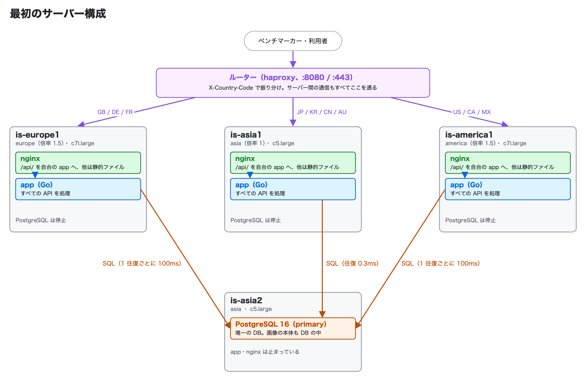
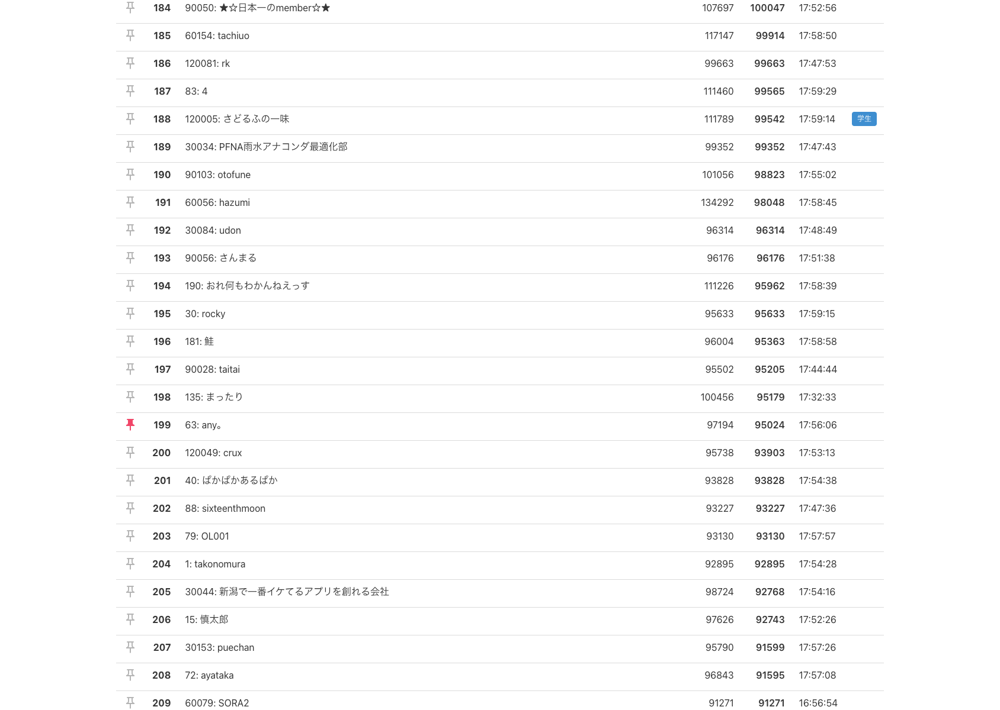
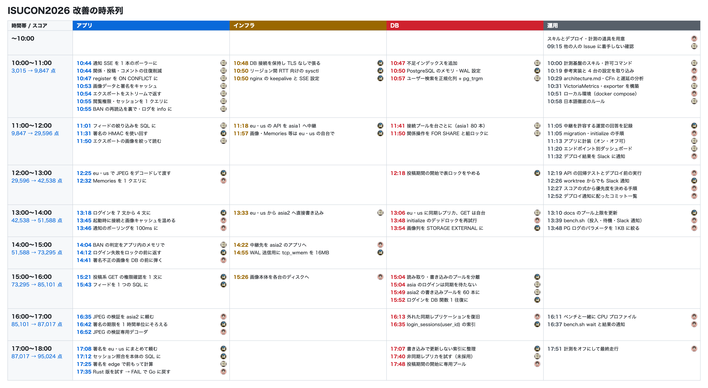
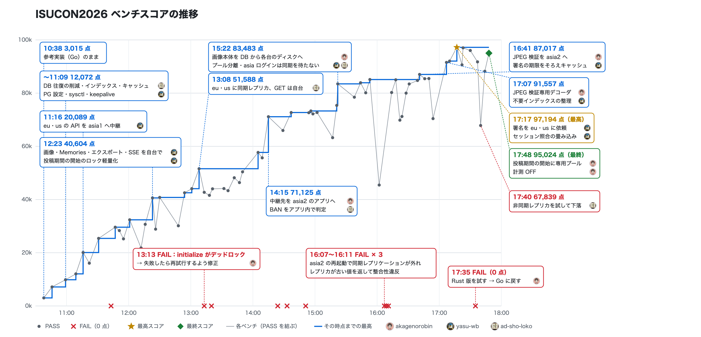
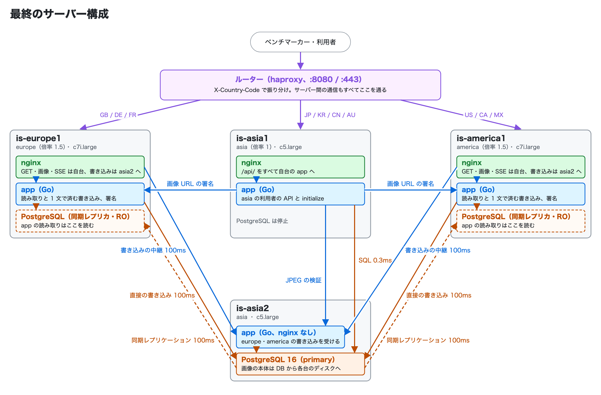

[ISUCON2026](https://isucon.net/) にチーム any。で参加しました。  

メンバーは any の同僚 [ad-sho-loko](https://github.com/ad-sho-loko) と [yasu-wb](https://github.com/yasu-wb) です。ウェブエンジニアとしてとても優秀でいつも頼りにしてますが、 ISUCON には参加したことがないという状態でした。

僕は2018年から5回 ISUCON には参加しており、同僚にも面白さを伝えたかったので、是非出ましょう！という感じで誘いました。

## 事前準備

勝手をわかってるのが僕だけだったので過去問の環境構築とスキルの準備を僕がやりました。

過去問の [ISUCON14](https://github.com/isucon/isucon14) の練習環境を [matsuu/aws-isucon](https://github.com/matsuu/aws-isucon) を使って AWS に構築しました。

練習は3時間程度行って雰囲気を掴むだけでしたが、片手間でやっても優勝チームの得点を超えたので「AI に任せたら何とかなるやろ〜」という感じで本番に臨みました。

スキルとしては下記の3つを用意していました。

| スキル | やること |
| --- | --- |
| isucon-init | 競技開始直後のセットアップ。ssh の設定、メンバーの公開鍵の配置、参考実装と設定ファイルのリポジトリへの取り込み、構成のドキュメント化、計測（JSON のアクセスログ・スロークエリログ・alp）の準備 |
| isucon-deploy | リポジトリのアプリと設定を全台に反映し、ビルド・再起動・疎通確認まで行う |
| isucon-analyze | ベンチの後にアクセスログ・スロークエリログ・リソースを集計し、ボトルネックと改善候補を優先度付きで洗い出す |

## 今年の問題

ISUReal という BeReal 的なアプリがお題でした。

特徴としては前回までの3台構成から4台構成になったこと、各サーバーのスペックが異なること、リクエストがルーター経由で各サーバーに割り振られること、リージョンが分かれていてリージョンまたぎの遅延が発生すること、かなと思います。

## 戦略

特に担当などは決めず、各々 Claude で改善を進めていくという感じで取り組みました。

オフィスでオフラインで行ったのでデプロイとベンチのタイミングは口頭で確認しつつ、途中からはデプロイ内容とベンチ結果が Slack 通知されるようになったり、リグレッションテストが追加されたりしました。

## 結果

スコアは 95,024 点でしたが、事後検証（Post Validation）NG で失格になってしまいました。

[結果発表](https://isucon.net/archives/60126600.html)

ちゃんとスコアが付いてれば199位だったみたいです。

## やったこと

以下のような感じで改善していったようです。

リージョン間の遅延がネックだよね〜ということでそれを減らすべくレプリケーションしたりリクエストを割り振ったりしていました。

後半に CPU 消費が偏ってるなということで CPU プロファイルをして画像処理が重そうだということに気付いて改善しましたがこのタイミングが遅かったなというのが反省です。

最終のサーバー構成は以下のようになりました。

## 敗因

画像をDBから剥がしたところかDBをレプリケーションするようにしたところの設定が足りていなくて追試で落ちたのかな…と思ってます。

そもそも Claude に「再起動試験した？」と訊いたときに「まだ他の人がサーバー使ってるからできないよ」と言われて、まあええか…と流したままコンテストを終えたのが良くなかったです。

AI を信用しすぎたことへの制裁かなと受け止めてます。

## 感想

AI エージェント時代初の ISUCON でしたが、個人的には AI のおかげで「こうしたら良さそうだけどそれやるには時間が…」とか「これやりたかったのにバグってできなかった。。。」みたいなのがなく、時間内に仮説検証を複数回回せてスコアも上げられたので、例年より楽しかったなという感想です。（チームメンバーは不満そうだったけど）

結果は残念でしたが改善点は多々あったのでまた挑戦したいです。

運営の皆さん、素晴らしい問題と環境をありがとうございました！
